

  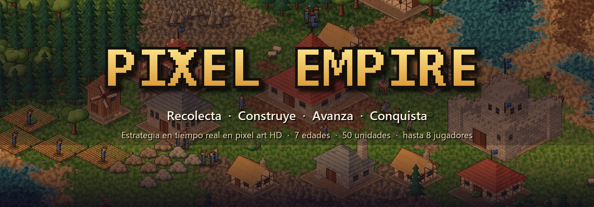

  

  
  
  
  
  

  <b>Un RTS clásico de construcción de imperios en pixel art HD.</b> 
  Empieza con un centro urbano y un puñado de aldeanos. Termina con tanques, reactores y una Maravilla. 
  Gratis · Sin conexión · Contra la IA o con tus amigos por red local

  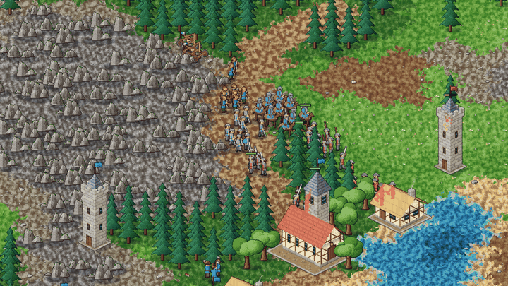

## ⚔️ Siete edades de guerra

De la Edad Oscura a la Edad Militar. Cada edad desbloquea unidades, edificios y
tecnologías nuevos, y la música cambia contigo.

<table>
  <tr>
    <td width="50%">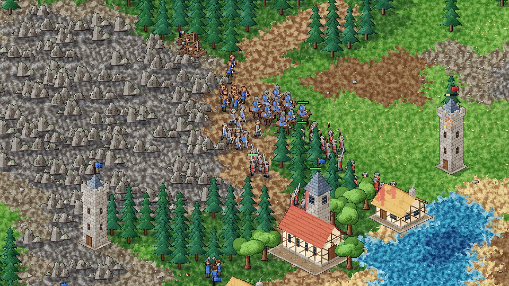</td>
    <td width="50%">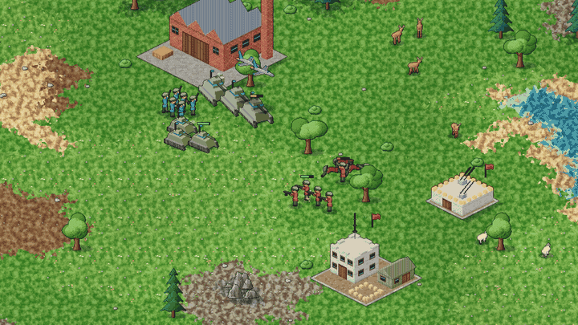</td>
  </tr>
  <tr>
    <td align="center"><b>Edad de los Castillos</b> · caballería, infantería, arqueros y catapultas</td>
    <td align="center"><b>Edad Militar</b> · tanques, bazucas, ametralladoras y reactores</td>
  </tr>
</table>

## 🏰 Levanta tu ciudad

  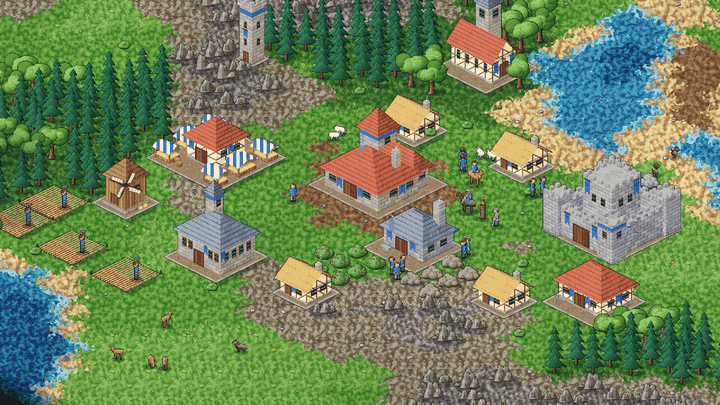

Granjas, molinos, mercados, monasterios, universidades, castillos, murallas y
puertos. **30 edificios**, cada uno pintado en pixel art con su propia
animación de construcción y sus llamas cuando arde.

## 🌅 Un mundo vivo

  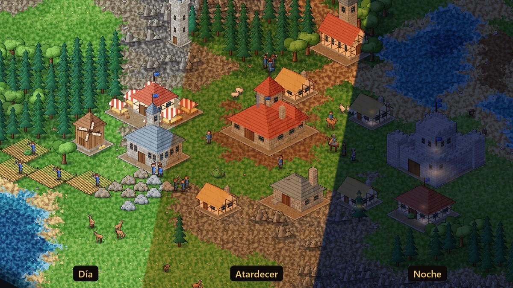

Ciclo de día y noche con luces en las ventanas, pájaros, sombras de nubes,
mariposas y luciérnagas. Ovejas y pavos que son de quien pase cerca, ciervos que
huyen, jabalíes que se defienden y lobos, tigres y osos que atacan.

## ✨ Todo lo que trae

<table>
  <tr>
    <td width="33%" valign="top">
      <h3>🛡️ 50 unidades</h3>
      Infantería, arqueros, caballería, asedio, monjes, barcos, armas de fuego,
      artillería, biplanos, tanques, reactores y bazucas. Animadas en 16 direcciones.
    </td>
    <td width="33%" valign="top">
      <h3>🗡️ Combate completo</h3>
      Posturas, formaciones, armaduras y bonificaciones, proyectiles visibles,
      daño en área, edificios en llamas y conversión con monjes.
    </td>
    <td width="33%" valign="top">
      <h3>💰 Economía</h3>
      Comida, madera, oro y piedra. Granjas, comercio entre mercados,
      compraventa de recursos y más de 30 tecnologías.
    </td>
  </tr>
  <tr>
    <td valign="top">
      <h3>🗺️ Mapas generados</h3>
      Continental, costa o islas, en cinco tamaños, con niebla de guerra.
      Semilla aleatoria o elegida por ti.
    </td>
    <td valign="top">
      <h3>🤖 IA en tres niveles</h3>
      Gestiona su economía, avanza de edad, ataca en oleadas e invade por mar.
    </td>
    <td valign="top">
      <h3>🌐 Multijugador</h3>
      Hasta 8 jugadores por LAN o VPN (Radmin, ZeroTier, Hamachi…). La IA toma
      el control si alguien se desconecta.
    </td>
  </tr>
  <tr>
    <td valign="top">
      <h3>⚙️ Partidas a medida</h3>
      Equipos y alianzas, dificultad por cada IA, recursos y edad iniciales,
      población, velocidad, animales y día y noche.
    </td>
    <td valign="top">
      <h3>🎵 Sonido en todo</h3>
      Música por edades que cambia en las batallas, voces, golpes, disparos,
      explosiones y ambiente. Todo sintetizado por el propio proyecto.
    </td>
    <td valign="top">
      <h3>💾 Guarda y sigue</h3>
      Guardar y cargar partidas, guardado rápido (F5), autoguardado,
      pantalla completa (F11) y español o inglés.
    </td>
  </tr>
</table>

## 📸 Galería

| | |
|---|---|
| 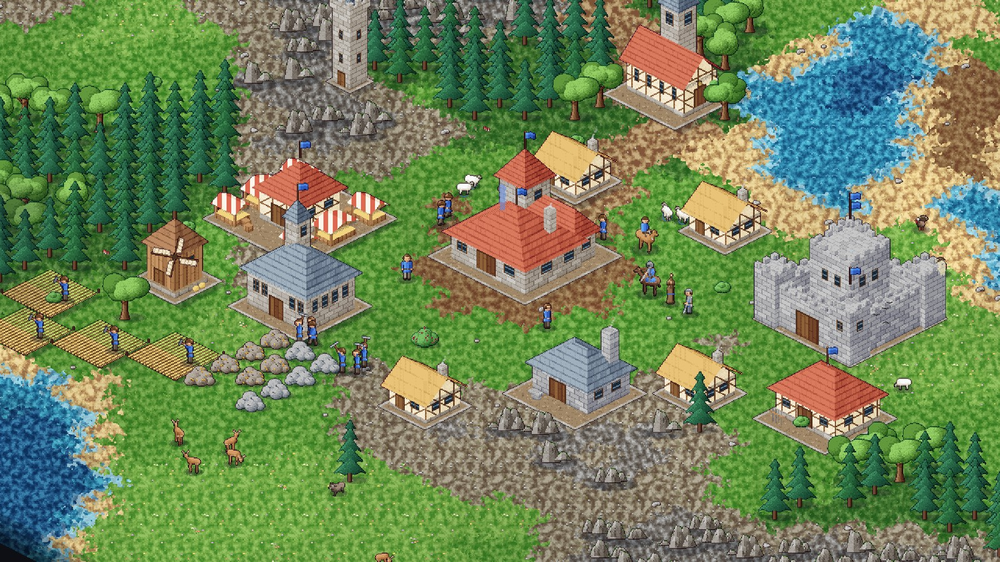 | 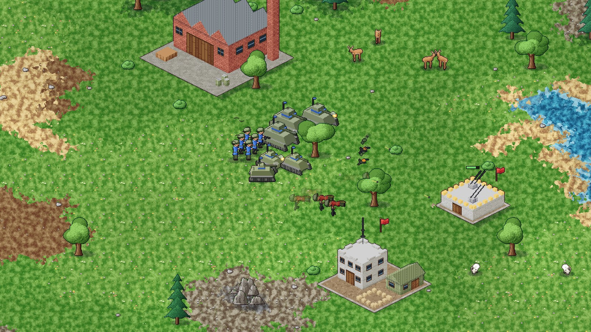 |
| Una ciudad de la Edad Imperial en pleno trabajo | Ofensiva de la Edad Militar contra un fuerte antiaéreo |
| 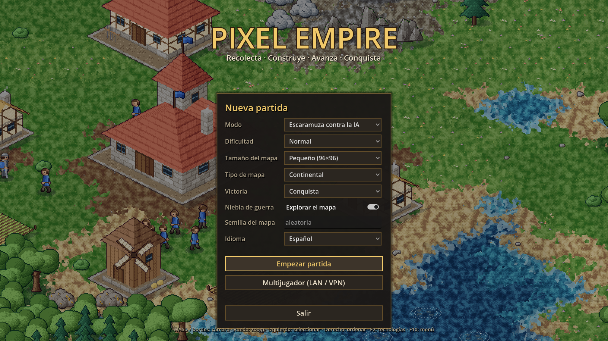 | 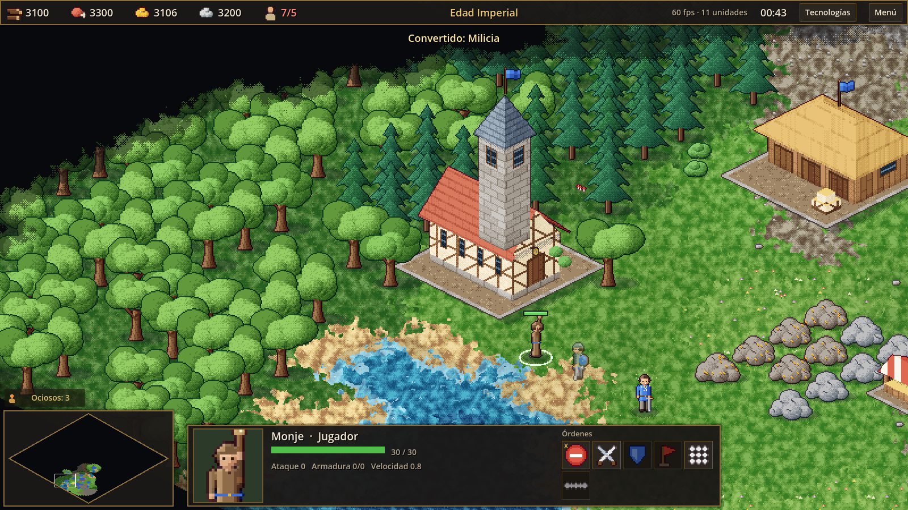 |
| Menú principal con la aldea animada de fondo | Monasterio, murallas y un monje convirtiendo |
| 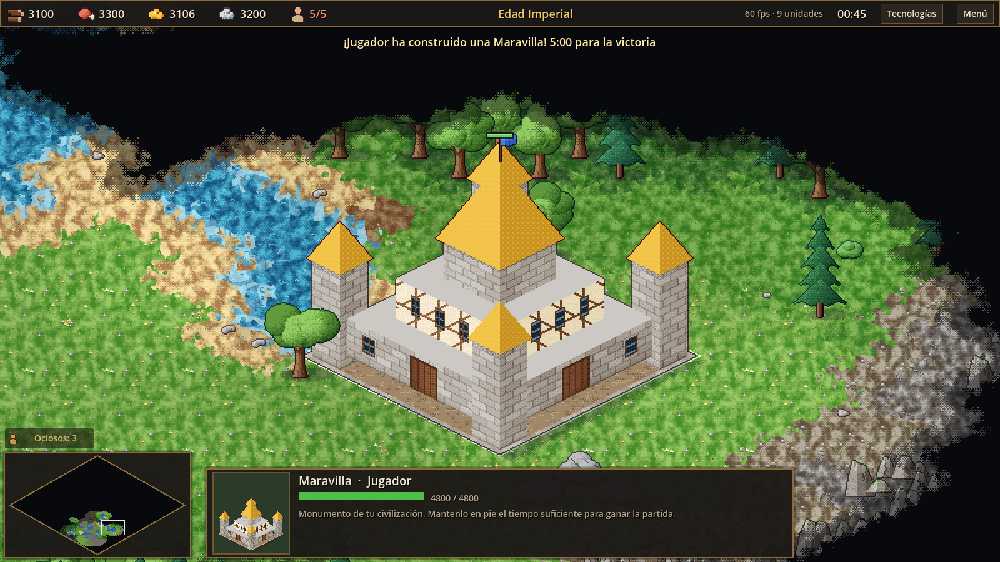 | 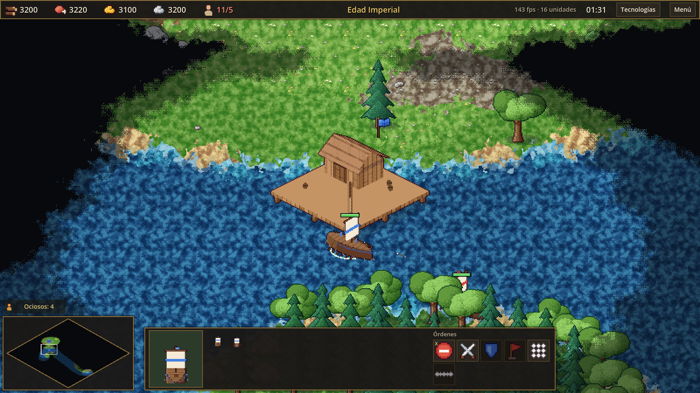 |
| La Maravilla: mantenla en pie y ganas | Mapa de islas, puerto y barcos |
| 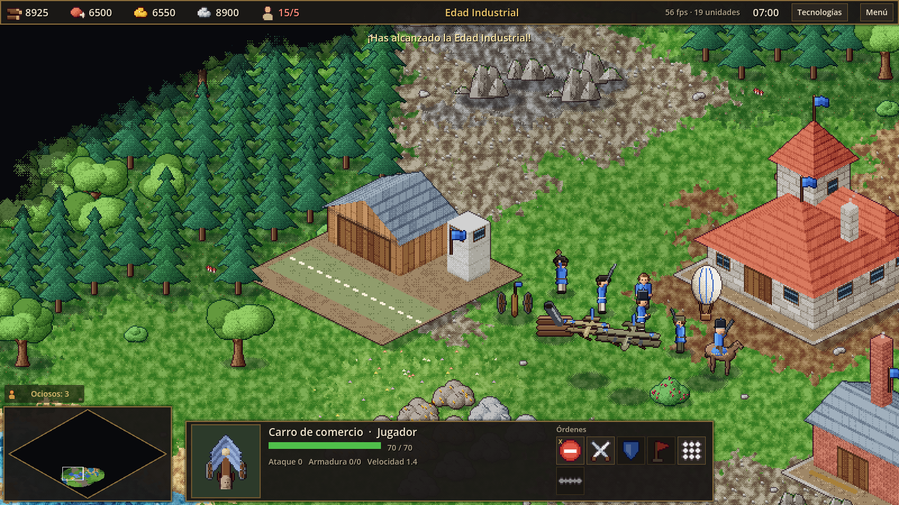 | 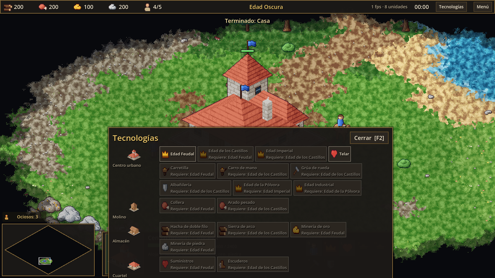 |
| Edad Industrial: aeródromo, artillería y fusileros | Árbol tecnológico (F2) |
| 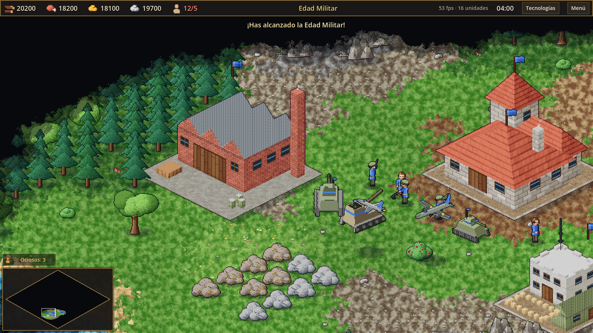 | 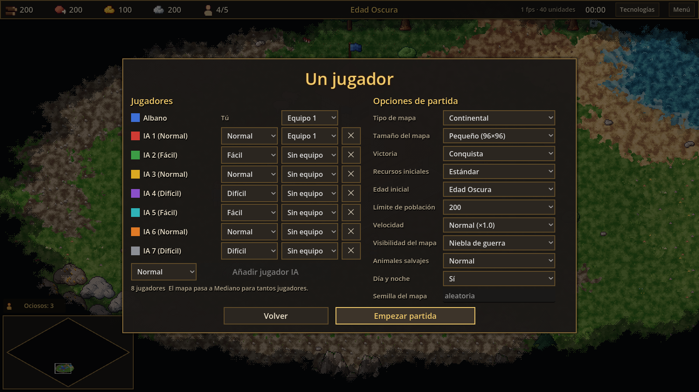 |
| Fábrica de tanques, tanques, reactores e infantería moderna | Hasta 8 jugadores, equipos y opciones |
| 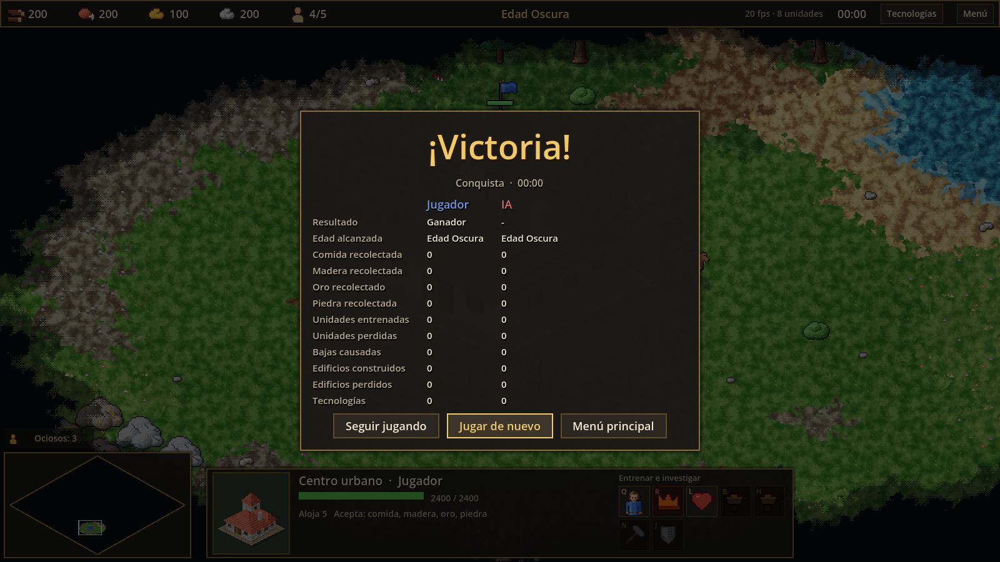 | 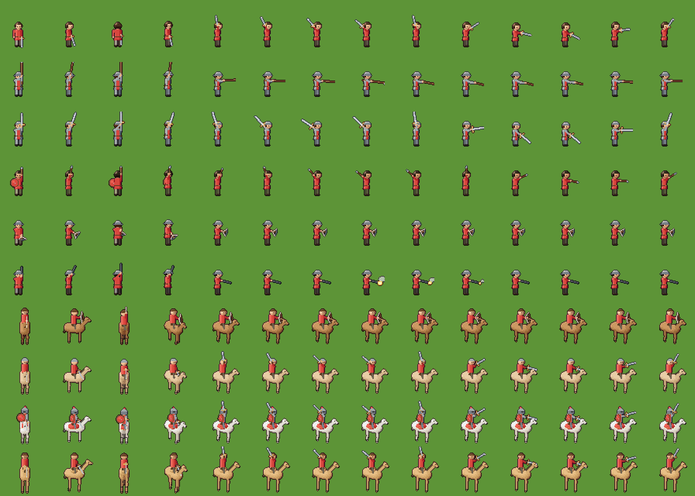 |
| Estadísticas al final de la partida | Animaciones de unidades en 16 direcciones |

## ⬇️ Instalar

1. Descarga `PixelEmpire_Setup_<versión>.exe` desde
   **[la última versión](../../releases/latest)**.
2. Ejecútalo. No necesita permisos de administrador.
3. Windows SmartScreen puede avisar porque el instalador no está firmado:
   pulsa *Más información → Ejecutar de todas formas*.

Requisitos: Windows 10 u 11 de 64 bits. Las versiones nuevas se instalan
encima de la anterior, o desde el botón **Actualizar** del menú principal.

## 🎮 Controles

<b>Ver todos los controles</b>

| Acción | Tecla / ratón |
|---|---|
| Mover la cámara | WASD, flechas o bordes de la pantalla |
| Zoom | Rueda del ratón |
| Seleccionar | Clic izquierdo o arrastrar (Mayús para añadir) |
| Ordenar (mover, atacar, recolectar, construir) | Clic derecho |
| Grupos de unidades | Ctrl + 0-9 para crear, 0-9 para seleccionar |
| Siguiente aldeano ocioso | `.` |
| Destruir lo seleccionado (unidades y edificios propios) | Supr |
| Cambiar de página de edificios | Tab |
| Seleccionar todos los de un tipo en pantalla | Doble clic o Ctrl + clic |
| Añadir un punto de ruta | Mayús + clic derecho |
| Añadir la selección a un grupo | Mayús + 0-9 |
| Encolar cinco unidades | Mayús + clic en el botón de entrenar |
| Siguiente unidad militar ociosa | `,` |
| Seleccionar el centro urbano | Inicio |
| Seleccionar todo el ejército | Ctrl + A |
| Ir al último ataque | Espacio |
| Centrar en la selección | Ctrl + Espacio |
| Velocidad de juego (un jugador) | + / - |
| Árbol tecnológico | F2 |
| Contador de FPS | F3 |
| Guardado rápido | F5 |
| Pantalla completa | F11 o Alt + Intro |
| Ayuda de controles | F1 |
| Menú de pausa | F10, Esc o Pausa |
| Chat (multijugador) | Intro |

Los botones de construcción, entrenamiento y tecnologías muestran su tecla
rápida en la esquina.

## 🛠️ Compilar desde el código

1. Descarga [Godot 4.7.2](https://godotengine.org/download/archive/4.7.2-stable/)
   (versión estándar, no .NET) y descomprímelo en `tools/godot/`.
2. Abre el proyecto con Godot o lanza `run_game.bat`.
3. Pruebas: `run_tests.bat` (comprobación de scripts, tests unitarios y
   partidas automáticas en ventana).
4. Instalador: `build_installer.bat`. Necesita
   [Inno Setup 6](https://jrsoftware.org/isinfo.php) y Python 3.

El código del juego está en `src/`, los datos de juego (unidades, edificios,
tecnologías, edades) en `assets/data/*.json` y las traducciones en
`assets/i18n/`. Las imágenes de este README salen de una partida real:
`--smoke=showcase` monta las escenas y `tools/readme/make_readme_media.py`
compone el banner, los GIFs y las capturas.

## 🤖 Cómo se hizo

Todo el juego (código, arte procedural en pixel art y datos) se ha creado con
[Claude Code](https://claude.com/claude-code) usando el framework
[Claude Code Game Studios](README-STUDIO.md), que organiza el trabajo en
agentes especializados. El arte lo generan scripts propios
(`tools/art/generate_art.gd`) y el sonido y la música se sintetizan
(`tools/audio/generate_audio.gd`), sin recursos de otros juegos.

## 📜 Licencia

El framework Claude Code Game Studios incluido en `.claude/` se distribuye
bajo la licencia MIT (ver [LICENSE](LICENSE)).

  

