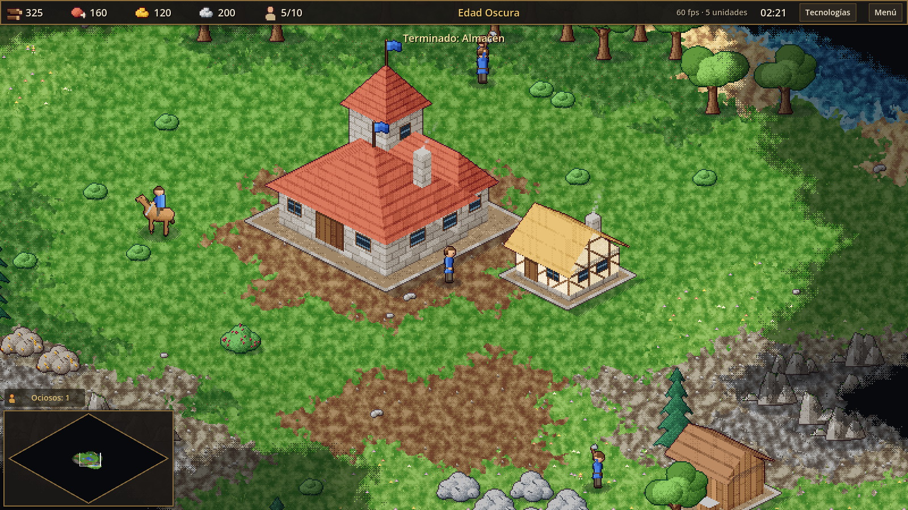

<h1 align="center">Pixel Empire</h1>

  Estrategia en tiempo real en pixel art HD, hecha con Godot 4.
   
  Recolecta · Construye · Avanza · Conquista

  <a href="../../releases/latest"><b>⬇ Descargar el instalador para Windows</b></a>

  

## El juego

Pixel Empire es un RTS clásico de construcción de imperios. Empiezas con un
centro urbano y un puñado de aldeanos. Desde ahí recolectas comida, madera, oro
y piedra, levantas tu ciudad, avanzas por siete edades y te enfrentas a la IA o a
tus amigos por red local.

- **Siete edades**: Oscura, Feudal, de los Castillos, Imperial, de la Pólvora,
  Industrial y Militar. Cada una desbloquea unidades, edificios y tecnologías nuevos.
- **50 unidades**: infantería, arqueros, caballería, asedio, monjes, barcos,
  armas de fuego, artillería, biplanos y, en la Edad Militar, tanques, aviones a
  reacción, ametralladoras y bazucas.
- **30 edificios**: desde la casa y el molino hasta castillos, murallas,
  puertas, mercados, puertos, aeródromos, fábricas de tanques y la Maravilla.
- **Combate completo**: posturas, formaciones, armaduras y bonificaciones,
  proyectiles visibles, daño en área, edificios en llamas y conversión con monjes.
- **Economía**: granjas, comercio entre mercados, compraventa de recursos y
  más de 30 tecnologías.
- **Mapas generados**: continental, costa o islas, en cinco tamaños, con
  niebla de guerra.
- **Partidas a medida**: hasta 8 jugadores con equipos y alianzas (los aliados
  comparten visión y ganan juntos), dificultad por cada IA, recursos y edad
  iniciales, límite de población, velocidad, visibilidad del mapa, cantidad
  de animales y ciclo de día y noche. Igual en solitario y en multijugador.
- **Fauna**: ovejas y pavos que son de quien pase cerca, ciervos que huyen,
  jabalíes que se defienden y lobos, tigres y osos que atacan. Los animales
  cazados dejan comida.
- **Sonido en todo**: música por edades que cambia durante las batallas,
  voces de selección y órdenes, golpes, disparos, explosiones, trabajo de los
  aldeanos, animales, ambiente de viento, agua, bosque y noche. Todo
  sintetizado por el propio proyecto.
- **Mundo vivo**: ciclo de día y noche con luces en las ventanas, pájaros,
  sombras de nubes, mariposas y luciérnagas.
- **Guardar y cargar** partidas, guardado rápido (F5) y autoguardado.
- **IA** en tres dificultades: gestiona su economía, avanza de edad, ataca en
  oleadas e invade por mar.
- **Multijugador** para hasta 8 jugadores por LAN o VPN (Radmin, ZeroTier,
  Hamachi…). La IA toma el control si alguien se desconecta.
- **Español e inglés**: se elige en el menú principal o en el de pausa.

## Capturas

| | |
|---|---|
|  |  |
| Menú principal con la aldea animada de fondo | Monasterio, murallas y un monje convirtiendo |
|  |  |
| La Maravilla: mantenla en pie y ganas | Mapa de islas, puerto y barcos |
|  |  |
| Edad Industrial: aeródromo, artillería y fusileros | Árbol tecnológico (F2) |
|  |  |
| Estadísticas al final de la partida | Algunas animaciones de unidades en 16 direcciones |
|  | |
| Edad Militar: fábrica de tanques, tanques, reactores e infantería moderna | |

## Instalar

1. Descarga `PixelEmpire_Setup_<versión>.exe` desde
   [Releases](../../releases/latest).
2. Ejecútalo. No necesita permisos de administrador.
3. Windows SmartScreen puede avisar porque el instalador no está firmado:
   pulsa *Más información → Ejecutar de todas formas*.

Requisitos: Windows 10 u 11 de 64 bits.

## Controles

| Acción | Tecla / ratón |
|---|---|
| Mover la cámara | WASD, flechas o bordes de la pantalla |
| Zoom | Rueda del ratón |
| Seleccionar | Clic izquierdo o arrastrar (Mayús para añadir) |
| Ordenar (mover, atacar, recolectar, construir) | Clic derecho |
| Grupos de unidades | Ctrl + 0-9 para crear, 0-9 para seleccionar |
| Siguiente aldeano ocioso | `.` |
| Destruir lo seleccionado (unidades y edificios propios) | Supr |
| Cambiar de página de edificios | Tab |
| Seleccionar todos los de un tipo en pantalla | Doble clic o Ctrl + clic |
| Añadir un punto de ruta | Mayús + clic derecho |
| Añadir la selección a un grupo | Mayús + 0-9 |
| Encolar cinco unidades | Mayús + clic en el botón de entrenar |
| Siguiente unidad militar ociosa | `,` |
| Seleccionar el centro urbano | Inicio |
| Seleccionar todo el ejército | Ctrl + A |
| Ir al último ataque | Espacio |
| Centrar en la selección | Ctrl + Espacio |
| Velocidad de juego (un jugador) | + / - |
| Árbol tecnológico | F2 |
| Contador de FPS | F3 |
| Guardado rápido | F5 |
| Ayuda de controles | F1 |
| Menú de pausa | F10, Esc o Pausa |
| Chat (multijugador) | Intro |

Los botones de construcción, entrenamiento y tecnologías muestran su tecla
rápida en la esquina.

## Compilar desde el código

1. Descarga [Godot 4.7.2](https://godotengine.org/download/archive/4.7.2-stable/)
   (versión estándar, no .NET) y descomprímelo en `tools/godot/`.
2. Abre el proyecto con Godot o lanza `run_game.bat`.
3. Pruebas: `run_tests.bat` (comprobación de scripts, tests unitarios y
   partidas automáticas en ventana).
4. Instalador: `build_installer.bat`. Necesita
   [Inno Setup 6](https://jrsoftware.org/isinfo.php) y Python 3.

El código del juego está en `src/`, los datos de juego (unidades, edificios,
tecnologías, edades) en `assets/data/*.json` y las traducciones en
`assets/i18n/`.

## Cómo se hizo

Todo el juego (código, arte procedural en pixel art y datos) se ha creado con
[Claude Code](https://claude.com/claude-code) usando el framework
[Claude Code Game Studios](README-STUDIO.md), que organiza el trabajo en
agentes especializados. El arte lo generan scripts propios
(`tools/art/generate_art.gd`) y el sonido y la música se sintetizan
(`tools/audio/generate_audio.gd`), sin recursos de otros juegos.

## Licencia

El framework Claude Code Game Studios incluido en `.claude/` se distribuye
bajo la licencia MIT (ver [LICENSE](LICENSE)).
